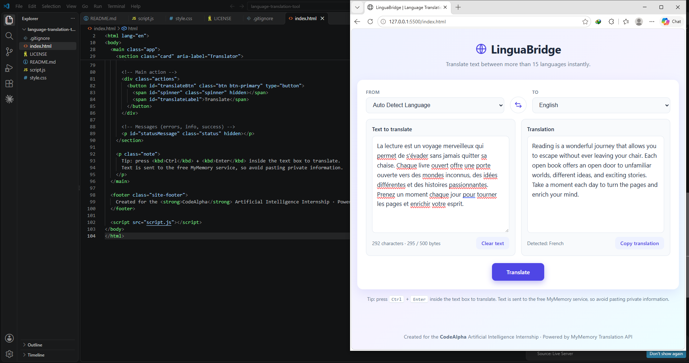
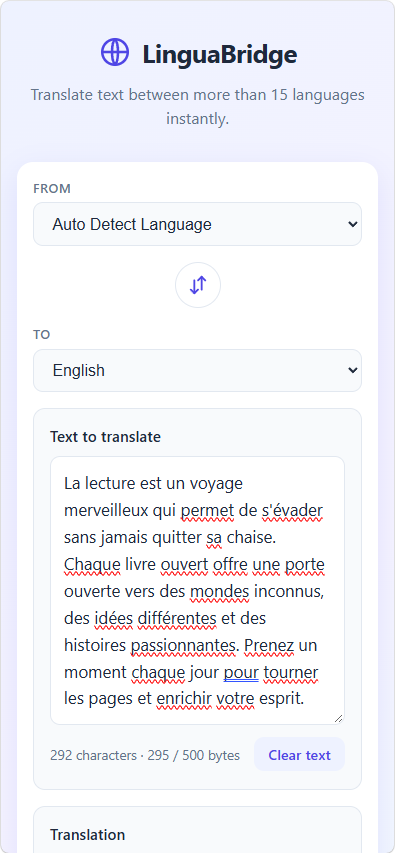

# LinguaBridge - Language Translation Tool

## Project Overview
LinguaBridge is a responsive web application that translates text between many languages using the **MyMemory Translation API**. It is built with plain HTML, CSS and JavaScript (no frameworks), so it is easy to read, run and learn from.

This project was created for **Task 1 of the CodeAlpha Artificial Intelligence Internship**.

## Features
- Text area for typing or pasting text
- Source language selector with **Auto Detect Language**
- Target language selector (17 languages including English, Urdu, Arabic, Hindi, French, Spanish, German, Chinese)
- Real translation through a live API (no fake or hardcoded translations)
- Translate, Copy Translation, Swap Languages and Clear Text buttons
- Loading spinner and disabled button while translating
- Friendly error messages (network errors, API errors, rate limit, timeouts)
- Empty-input and text-length validation before any request
- Character and byte counter
- Right-to-left display for Arabic, Urdu and Persian output
- Responsive layout (desktop, tablet, mobile)
- Safe rendering (`textContent`, never `innerHTML`)

## Technologies Used
- HTML5
- CSS3 (Grid, Flexbox, animations, media queries)
- Vanilla JavaScript (async/await, Fetch API)
- MyMemory Translation API

## Screenshots
Add screenshots after running the project:
1. Create a folder named `screenshots` in the project.
2. Take screenshots (Windows: press `Win + Shift + S`) of the desktop and mobile views.
3. Save them as `screenshots/desktop.png` and `screenshots/mobile.png`.
4. Uncomment these lines:

```markdown
<!--  -->
<!--  -->
```

## Project Structure
```
language-translation-tool/
├── index.html    # Page structure
├── style.css     # Styling and responsive design
├── script.js     # Application logic and API code
├── README.md     # Documentation
├── .gitignore    # Files Git should ignore
└── LICENSE       # MIT License
```

## Prerequisites
- A modern browser (Chrome, Edge, Firefox, Safari)
- An internet connection (the API is online)
- Optional: Python 3 or VS Code with the Live Server extension for a local web server
- Optional: Git, to upload the project to GitHub

## Installation and Running (Windows, PowerShell)

**Option A: Open the file directly**
```powershell
cd path\to\language-translation-tool
start index.html
```

**Option B: Run a local server (recommended)**
```powershell
cd path\to\language-translation-tool
python --version
python -m http.server 5500
```
Then open http://localhost:5500 in your browser. Press `Ctrl + C` in PowerShell to stop the server.

**Option C: VS Code Live Server**
Install the "Live Server" extension, then right-click `index.html` and choose **Open with Live Server**.

## API Details and Limitations
- **API:** MyMemory (`https://api.mymemory.translated.net/get`)
- **Request format:** `?q=TEXT&langpair=SOURCE|TARGET`, for example `langpair=en|ur`
- **API key:** not required
- **Text size:** about 500 bytes per request. Urdu, Arabic, Hindi and Chinese use more bytes per character, so fewer characters fit.
- **Daily limit:** anonymous usage has a small free daily quota (roughly 5,000 characters per day per IP). A valid email passed as the `de` parameter raises it (roughly 50,000). To use it, set `CONTACT_EMAIL` in `script.js`. Limits can change, so check the [official MyMemory documentation](https://mymemory.translated.net/doc/spec.php).
- **Auto Detect:** MyMemory supports `Autodetect`, but detection can be inaccurate for short or mixed-language text. If results look wrong, choose the source language manually.
- **Quality:** translations come from a mix of machine translation and community translation memory, so quality varies by language pair. Do not rely on it for legal, medical or official documents.

## Usage
1. Choose a source language (or keep **Auto Detect Language**).
2. Choose a target language.
3. Type or paste text.
4. Click **Translate** (or press `Ctrl + Enter`).
5. Use **Copy translation** to copy the result.
6. Use the swap button to reverse languages, and **Clear text** to start over.

## Common Errors and Troubleshooting
| Problem | Solution |
|---|---|
| "Network error" | Check your internet connection, and any firewall or VPN. |
| "Free daily limit reached" | Wait until tomorrow, or add an email in `CONTACT_EMAIL`. |
| "API rejected this language pair" | Pick the source language manually instead of Auto Detect. |
| "Text is too long" | Shorten the text to fit within 500 bytes. |
| Copy button does not work | Run through `http://localhost` (Option B) instead of opening the file directly. |
| Wrong auto-detected language | Select the source language manually. |
| Page looks unstyled | Make sure `index.html`, `style.css` and `script.js` are in the same folder. |

## Security and Privacy
- No API keys or secrets exist in this project.
- Text you enter is sent to a third-party service (MyMemory). Do not translate passwords, personal or confidential information.
- User text is displayed with `textContent`, which prevents HTML/script injection.
- If you switch to an API that needs a key, add a backend server and store the key in an environment variable (`.env`, already in `.gitignore`). Never put private keys in frontend JavaScript.

## Future Improvements
- Text-to-speech and speech-to-text
- Translation history using `localStorage`
- Dark mode
- Support for longer text by splitting it into chunks
- A backend proxy with a paid API (Google Cloud Translation, DeepL) for higher quality
- Download translation as a text file
- Automated tests

## CodeAlpha Internship Task Reference
**CodeAlpha Artificial Intelligence Internship - Task 1: Language Translation Tool.**
Build a tool that translates text between languages using a translation API, with source and target language selection and a user-friendly interface.

## Author
- **Name:** DANIYAL BILAL
- **GitHub:** [github.com/DaniyalBilal10]
## License
This project is licensed under the MIT License. See the [LICENSE](LICENSE) file.